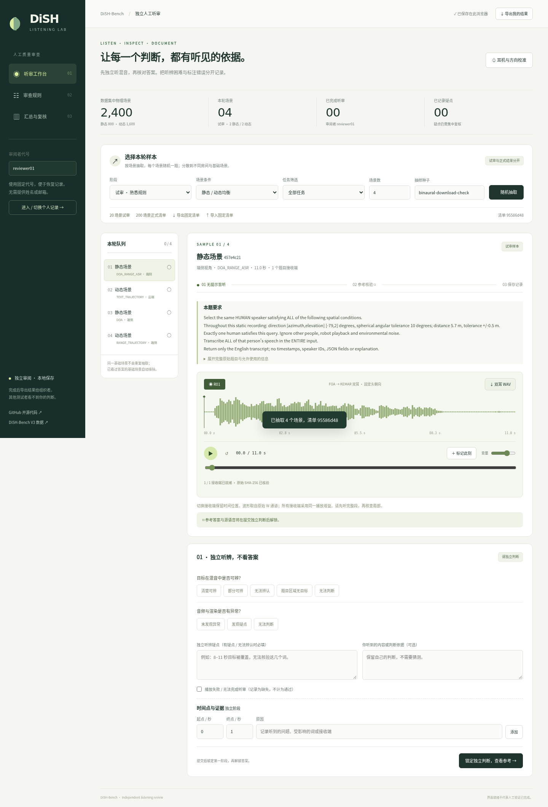

# DiSH · Listening Lab

An open-source workbench for **independent, two-stage human quality review** of DiSH-Bench. Reviewers randomly sample real scenes, listen to FOA mixtures through a binaural decoder, lock their independent observations, and then inspect the reference answer and original source speech.

**[Open the listening workbench](https://wenanzhi.github.io/dish-listening-review/)** · [Benchmark source](https://github.com/Wenanzhi/DisRobot-bench) · [Dataset](https://huggingface.co/datasets/Heiheihaha17/DiSH-Bench-exhibition-v3)



## 给测试者

1. 输入固定的审阅者代号。戴耳机，完成左右声道与方向校准，记录播放设备。
2. 随机抽取一组场景，或导入组织者提供的固定清单。20 场景试审和 200 场景正式抽样提供快捷设置；数量也可自行修改。
3. 第一阶段只看题目允许的信息，听完整混合录音。记录可辨程度、音频异常、时间区间与原因，再锁定独立判断。
4. 第二阶段核对参考答案、目标身份、无损原始语音片段和轨迹。可切换全部接收端在同一时间点检查。分别记录音频与渲染、语音与文字、问题与目标、空间与时间，以及跨接收端对应。
5. 完成后点击 **导出我的结果**，把 JSON 交给组织者。浏览器本地保存进度；网站没有自动上传结果的服务器。共享设备请使用不同的浏览器配置。

听不清可能是合理难度，不应自动标为标注错误。空区域题也不要求整个录音安静。当前提供的是可运行的听审工具，**不代表独立人工验证已经完成**，也不生成虚构的人类评价。

## 给组织者

- 正式听审时，让同样三名审阅者导入**同一份清单**（静态 100、动态 100 是建议起点）。每人独立提交后再讨论。每个场景随机一题，清单固定场景和题目 ID。
- 抽样使用可复现种子，静动配额和随机房间轮询，跨静动不重复基础场景；排除该审阅者已看过答案的基础场景。采样不按难度、听感或模型分数挑选。所有细分条件的充分覆盖仍须组织者检查。
- `汇总与复核` 可导入多份结果，并按维度显示原始一致率、名义 Krippendorff’s α、疑点数、无法判断比例，以及完整共同样本数。试审、先前曝光和播放失败的记录不进入正式统计。
- “无法判断”计为单独名义类别并单独报告；“不适用”作为缺失。没有可比较样本或恒定评分时 α 未定义。原始一致率使用恰好预期人数的完整共同样本；α 使用至少两人评分的单位。
- 集中复核结论单独记录为确认错误、已修正、合理困难、未确认异常或待复核。导出的统计包保留独立记录与最终处理，不重写讨论前的判断。
- 导出会分别报告物理场景、不同接收端录音与问题数量；多道题不能当成多段独立音频。

## Data and playback

The complete index contains **2,400 physical realizations (800 static / 1,600 dynamic), 4,761 FOA recordings, 39,999 questions, and 2,005 lossless source crops**. This is the full frozen V3 task revision, not a hand-picked demo. Large mixture WAVs stream on demand from Hugging Face revision `87e9f4d5394887d5d8a262ae8497ff2ba0089627`; the browser verifies their SHA-256 before decoding. Source crops and sharded prompts/references are served by GitHub Pages.

FOA is 16 kHz **ACN/SN3D [W,Y,Z,X]**, receiver-local X front / Y left / Z up. The app explicitly parses all four WAV channels and convolves with a KEMAR first-order HRTF filter bank. It never treats the first two FOA channels as stereo. All ears/channels share one user gain; there is no per-recording normalization. HRIR delays and the convolution tail are retained. Playback is at original speed with fixed orientation aligned to each receiving robot.

The source clips are the exact dry original crops, with mixture-clock start/end labels. Isolated room-rendered target stems are **not** supplied. The scene plot visualizes reference labels and is not independent evidence of their correctness. Generic HRTFs and headphones limit spatial judgment; exact angle/distance/world-coordinate validation remains a geometric/rendering check. See [protocol and limitations](docs/PROTOCOL.md) and [licenses](DATA_LICENSES.md).

## Local use

No build or production npm dependencies are required. Serve the `web` directory over HTTP(S); opening `index.html` via `file://` will not work.

```sh
python3 -m http.server 8765 --directory web
# Open http://localhost:8765
```

For Python versions before 3.7: `cd web && python3 -m http.server 8765`.

```sh
npm test
node scripts/validate_data.mjs
# Browser verification (optional development dependency):
npm ci
npx playwright install chromium
# Start the local HTTP server first. Optional: supply a locally downloaded release.
DISH_DATASET_ROOT=/path/to/dish_exhibition_test_v3_hf_tasks3 npm run test:browser
```

Browser QA creates disposable **TEST ONLY** synthetic judgments; these never become study records or published results. Browser binaries may be selected with `PLAYWRIGHT_CHROMIUM_EXECUTABLE`.

Rebuild the data with Python, numpy and soundfile; rebuild the decoder with numpy, scipy and h5py:

```sh
python scripts/build_data.py --dataset /path/to/frozen_hf_release \
  --sources /path/to/extracted_reproduction_inputs --output web
python scripts/build_decoder.py /path/to/MIT_KEMAR_normal_pinna.sofa web/assets/decoder.json
```

The builder verifies the frozen metadata hashes and original source-file hashes, joins by exact IDs, and retains all questions. It does not regenerate scenes, rewrite labels, or change mixture audio. The published site uses the `gh-pages` branch containing the exact `web/` tree. `scripts/publish_pages.sh` runs the checks, creates that deployment commit and pushes it; configure GitHub Pages to serve the branch root. An optional Actions workflow template is provided in `docs/examples/pages-workflow.yml` for credentials with workflow permission.

## Evidence and privacy boundaries

Blind-stage judgments are locked by the normal UI before reference files are fetched. This public static application cannot prevent a participant from deliberately inspecting public source files or a prior dataset release. It provides workflow blinding, not a secure experimental server. Reviewer IDs are local labels, not authenticated identities. Results are stored only in the current browser and need explicit export; local storage can be edited or cleared. No model is used to invent or auto-complete human ratings.

Application code: MIT. Dataset, speech and HRTF assets: component-specific terms in [DATA_LICENSES.md](DATA_LICENSES.md).

The player also exports the decoded stereo signal as a 16 kHz PCM16 **binaural WAV** at the current common playback gain, including the FIR tail. Export rejects clipping; it never substitutes the first two FOA channels or normalizes receivers independently. Offline listening does not advance the web study’s playback coverage.
